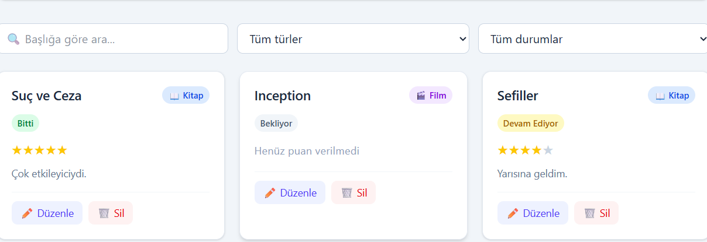

# 📚 Kitap/Film Listem

Okuduğum kitapları ve izlediğim filmleri takip ettiğim basit bir web uygulaması. Web Geliştirme / JavaScript eğitim programı proje ödevi olarak hazırlandı.

🔗 **Canlı site:** 
(https://github.com/caglaab/kitap-film-listem)

## Ekran Görüntüsü



## Özellikler

- ➕ Yeni kitap/film ekleme
- 📋 Kayıtları kart olarak listeleme
- ✏️ Kayıt güncelleme
- 🗑️ Kayıt silme (onaylı)
- 💾 Veriler LocalStorage'da saklanır, sayfa yenilenince kaybolmaz
- 🔍 Başlığa göre arama, tür ve duruma göre filtreleme
- 📊 Toplam, kitap, film ve biten sayacı
- 📱 Mobil uyumlu (responsive) tasarım

## Kullanılan Teknolojiler

- React
- Vite
- Tailwind CSS
- LocalStorage

## Kurulum

```bash
git clone https://github.com/KULLANICI_ADIN/kitap-film-listem.git
cd kitap-film-listem
npm install
npm run dev
```

Uygulama `http://localhost:5173` adresinde çalışır.

## Proje Yapısı

```
src/
├── Components/   (Navbar, ItemForm, ItemCard, ItemList, FilterBar)
├── Pages/        (Home)
├── Interfaces/   (itemModel.js: kayıt modeli ve sabitler)
├── utils/        (storage.js: LocalStorage işlemleri)
├── App.jsx
└── main.jsx
```